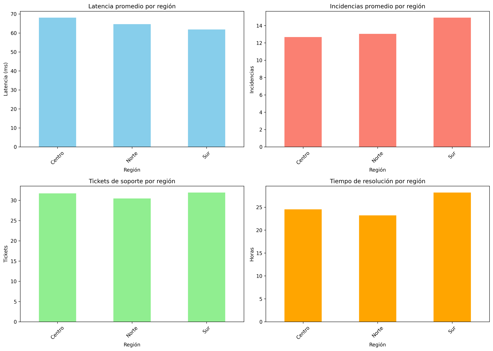
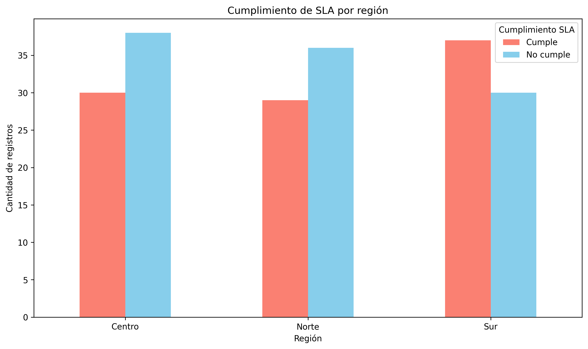

# RedConecta Telecom – Proyecto de Ciencia de Datos

**Asignatura:** Ciencia de Datos  
**Institución:** Instituto Profesional IACC  
**Semana:** 8  
**Año:** 2026

## 1. Descripción del proyecto

Este proyecto tiene como finalidad aplicar herramientas de ciencia de datos para analizar información operacional de una empresa de telecomunicaciones denominada RedConecta Telecom.

A través de Python, realicé un análisis exploratorio de los registros disponibles, considerando indicadores relacionados con el tráfico de datos, la latencia, las incidencias reportadas, los tickets de soporte, los tiempos de resolución y el cumplimiento de los acuerdos de nivel de servicio (SLA).

## 2. Objetivo

Mi objetivo es identificar patrones y diferencias en el desempeño operacional entre las regiones Centro, Norte y Sur, utilizando técnicas de análisis y visualización de datos que permitan apoyar la toma de decisiones.

## 3. Herramientas utilizadas

- Python
- Google Colab
- Pandas
- Matplotlib
- Git y GitHub
- Microsoft Excel

## 4. Conjunto de datos

Utilicé el archivo `dataset_set_D_telecomunicaciones.xlsx`, que contiene 200 registros y 10 variables.

Las variables analizadas incluyen fecha de registro, región, tipo de servicio, tráfico de datos, latencia, incidencias, tickets de soporte, tiempo de resolución, clientes afectados y cumplimiento del SLA.

Durante la exploración inicial comprobé los tipos de datos, la existencia de valores nulos y las estadísticas descriptivas.

## 5. Desarrollo del análisis

El proyecto contempla las siguientes actividades:

1. Carga y exploración inicial del conjunto de datos.
2. Revisión de calidad y estructura de la información.
3. Cálculo de indicadores operacionales por región.
4. Elaboración de visualizaciones comparativas.
5. Análisis del cumplimiento de SLA.
6. Generación de reportes en Excel.
7. Organización y publicación de resultados en GitHub.

## 6. Resultados principales

A partir del análisis exploratorio identifiqué diferencias en el desempeño operacional de las tres regiones.

En cuanto al cumplimiento del SLA, obtuve los siguientes resultados:

| Región | Cumple | No cumple |
|---|---:|---:|
| Centro | 30 | 38 |
| Norte | 29 | 36 |
| Sur | 37 | 30 |

La región Sur presentó una mayor cantidad de registros que cumplen el SLA, mientras que en Centro y Norte predominan los incumplimientos.

Considero que estos resultados permiten identificar oportunidades de mejora en la gestión del soporte técnico y en el seguimiento de los indicadores de servicio.

## 7. Visualizaciones

### Dashboard operacional

### Cumplimiento de SLA por región

## 8. Estructura del repositorio

- `data/`: conjunto de datos utilizado.
- `scripts/`: archivos Python para análisis exploratorio y visualización.
- `dashboards/`: gráficos generados.
- `reportes/`: reportes de soporte técnico y experiencia de clientes.
- `documentacion/`: documentación del flujo de trabajo.
- `RedConecta_Telecom_Semana8.ipynb`: notebook desarrollado en Google Colab.

## 9. Conclusiones

Mediante este proyecto pude aplicar conocimientos de ciencia de datos a un escenario de telecomunicaciones, integrando el procesamiento de información, el análisis estadístico descriptivo y la visualización de indicadores.

Considero que el uso de Python y Pandas facilita la exploración de los datos, mientras que los gráficos permiten comunicar de manera más clara las diferencias entre regiones.

Finalmente, la utilización de GitHub me permitió organizar y documentar los archivos del proyecto, favoreciendo la trazabilidad y reproducibilidad del trabajo realizado.
